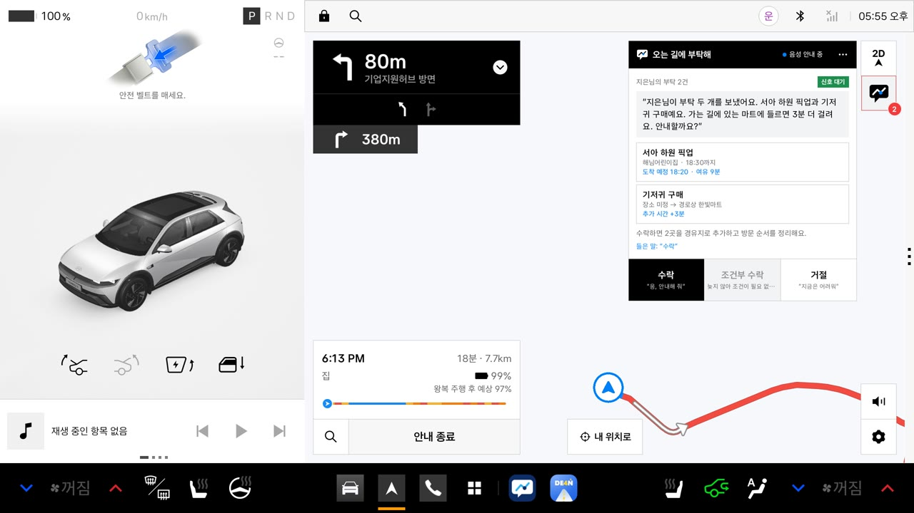

# 오는 길에 부탁해

> 가족이 휴대폰으로 보낸 부탁을 **차량이 음성으로 전달**하고, **수락 한 번으로 경유지 안내까지** 연결하는 Pleos Connect 차량 앱

- **팀명**: H68
- **APK**: [`apk/H68_오는길에부탁해_release.apk`](apk/H68_오는길에부탁해_release.apk)
- **시연 영상**: [`video/H68_오는길에부탁해_시연영상.mp4`](video/H68_오는길에부탁해_시연영상.mp4)

---

## 목차

1. [서비스 소개](#1-서비스-소개)
2. [시연 영상](#2-시연-영상)
3. [APK 파일 위치](#3-apk-파일-위치)
4. [테스트 환경](#4-테스트-환경)
5. [실행 방법](#5-실행-방법)
6. [필요한 설정](#6-필요한-설정)
7. [테스트 방법](#7-테스트-방법)
8. [소스에서 빌드하기](#8-소스에서-빌드하기)
9. [저장소 구성 및 참고 문서](#9-저장소-구성-및-참고-문서)
10. [알려진 제약](#10-알려진-제약)

---

## 1. 서비스 소개

맞벌이 부부의 하원 픽업이나 장보기 부탁은 대부분 메신저로 오지만, 받는 사람은 이미 운전 중인 경우가 많습니다.
'오는 길에 부탁해'는 부탁을 휴대폰이 아니라 **차량이 받도록** 해서 **듣고(음성) → 바로 가고(경유지) → 자동으로 알리는(상태 알림)** 흐름을 차 안에서 끝냅니다.

차량 앱은 별도 화면 없이 **Pleos 내비 오른쪽 위(2D 버튼 아래)의 아이콘 버튼**으로 동작합니다.

| 기능 | 설명 |
| --- | --- |
| 부탁 알림 | 새 부탁이 오면 버튼에 빨강 숫자 배지가 뜨고, 안전한 순간(신호 대기·저속·정차)에 음성으로 안내 |
| 3단계 응답 | 수락 / 조건부 수락 / 거절. 조건부 수락은 차량 도착 예정 시간으로 "18:50 도착 가능" 제안을 만들어 요청자에게 전송 |
| 경유지 자동 등록 | 수락하면 Pleos 내비에 경유지가 추가되고 안내 시작. 장소 미정 부탁은 Pleos 지도 검색으로 연결 |
| 진행 상태 자동 공유 | 경유지 도착·출발 이벤트로 "도착 → 완료"를 자동 공유. 위치는 공유하지 않음 |
| 주행 안전 | 주행 중에는 목록·터치 조작을 막고 음성으로만 응답. 고속·교차로 구간은 알림 보류 |
| Gleo AI | 부탁 수락·조건부 수락·남은 부탁 읽기 (`pleos-app/src/main/assets/schema.json`) |

## 2. 시연 영상

[](video/H68_오는길에부탁해_시연영상.mp4)

▶ [`video/H68_오는길에부탁해_시연영상.mp4`](video/H68_오는길에부탁해_시연영상.mp4) (2분 20초 · 2560×1440 · Pleos Connect 에뮬레이터 v2.1.0 화면 녹화)

> GitHub 웹에서는 README 안에서 바로 재생되지 않습니다. 이미지를 누르면 파일 화면으로 이동하고, 그곳의 **View raw** 또는 다운로드로 재생할 수 있습니다.

기획안의 **시나리오 A(즉시 수락)**에 장소 미정 부탁 한 건을 더해, 부탁 수신부터 완료까지 차량 화면에서 진행되는 모습을 담았습니다.

| 시간 | 장면 |
| --- | --- |
| 0:00 | Pleos 내비 위의 '오는 길에 부탁해' 버튼과 대기 화면 |
| 0:08 | 지은님의 부탁 2건 도착. 시속 72km 주행 중이라 **안내 보류**, 버튼에 숫자 배지만 표시 |
| 0:16 | 신호 대기에서 **음성 안내**: "서아 하원 픽업과 기저귀 구매예요. 가는 길에 있는 마트에 들르면 3분 더 걸려요." → 수락 / 조건부 수락 / 거절 |
| 0:24 | 음성으로 **"수락"** → 해님어린이집·한빛마트 **경유지 2곳 자동 추가**, 방문 순서 정리, 지은님께 도착 예정 시간 공유 |
| 0:48 | 해님어린이집 **도착 자동 인식** → 출발하면 '픽업 완료' 자동 공유 |
| 1:12 | 한빛마트 도착 → 출발하면 '구매 완료', **부탁 2건 완료** |
| 1:28 | 새 부탁 "우유 2팩" (장소 미정) → 경로상 마트 추천, 추가 3분 → 수락 |
| 2:00 | **부탁 3건 모두 완료** 후 집으로 안내 |

## 3. APK 파일 위치

| 항목 | 경로 |
| --- | --- |
| 차량 앱 (Pleos Connect, release) | [`apk/H68_오는길에부탁해_release.apk`](apk/H68_오는길에부탁해_release.apk) |

- 패키지명: `com.pleose.car` · 버전 0.2.0 (versionCode 2)
- release 키로 서명된 실행 가능한 APK입니다 (약 44MB).

## 4. 테스트 환경

| 항목 | 내용 |
| --- | --- |
| 에뮬레이터 | **Pleos Connect Emulator v2.1.0** (AVD `Pleos_Connect_v2.1.0`, `release_connect_v2.1.0`) |
| 화면 규격 | **2560 × 1440 px, 160 dpi** (가로) |
| OS | Android 14 (API 34), 앱 사용자 `user 10` |
| Pleos 내비 | 내비 앱 v3.3.2-rc5-hotfix.3 · 내비 서비스 v3.0.4 (에뮬레이터 기본 탑재) |
| 앱 SDK | minSdk 28 · targetSdk 34 · compileSdk 36 |
| Pleos Connect SDK | NaviHelper 3.0.5 · TextToSpeech 3.3.1 · SpeechToText 3.3.1 · Vehicle 2.3.2 |
| 개발 도구 | Android Studio (내장 JBR 21), Gradle Wrapper |

## 5. 실행 방법

### 5.1 설치

Pleos Connect 에뮬레이터를 켠 뒤:

```bash
adb install --user 10 apk/H68_오는길에부탁해_release.apk
```

> 같은 패키지의 debug 빌드가 이미 설치되어 있으면 서명이 달라 설치되지 않습니다. 먼저 `adb uninstall --user 10 com.pleose.car`로 지워 주세요.

### 5.2 처음 실행

1. 앱 목록에서 **오는 길에 부탁해**를 엽니다.
2. 설정 화면에서 **[허용하기]**를 눌러 위치·음성·차량 속도 권한을 허용합니다.
3. '내비 위에 표시'를 adb로 허용합니다 ([6. 필요한 설정](#6-필요한-설정)).
4. 오른쪽 **[단독 데모 시작]**을 누르면 Pleos 내비로 넘어가고, 내비 오른쪽 위에 아이콘 버튼이 뜹니다.

이후에는 앱 아이콘을 누르면 바로 내비로 넘어갑니다. 설정은 패널의 톱니 버튼으로 다시 열 수 있습니다.

## 6. 필요한 설정

Pleos Connect에는 '다른 앱 위에 표시' 설정 화면이 없어 에뮬레이터에서는 adb로 허용합니다 (재설치 전까지 유지).

```bash
# 필수: 내비 위에 버튼·패널 표시
adb shell appops set --user 10 com.pleose.car SYSTEM_ALERT_WINDOW allow

# 선택: 내비가 화면에 있을 때만 버튼 표시 (없으면 항상 표시)
adb shell appops set --user 10 com.pleose.car GET_USAGE_STATS allow
```

권한 팝업을 건너뛰고 싶으면 adb로 한 번에 허용할 수도 있습니다.

```bash
for p in android.permission.ACCESS_FINE_LOCATION android.permission.ACCESS_COARSE_LOCATION \
         android.car.permission.CAR_SPEED android.permission.RECORD_AUDIO android.permission.POST_NOTIFICATIONS; do
  adb shell pm grant --user 10 com.pleose.car $p
done
```

- **네트워크**: 단독 데모와 시연 시나리오는 서버 없이 동작합니다. 가족 앱과 실제로 연결할 때만 중계 서버가 필요합니다 ([7.3](#73-가족-앱과-연결-선택)).
- **음성 인식**: 기본은 온디바이스 인식입니다. 인식이 안 되는 환경에서는 패널의 응답 버튼으로 같은 동작을 할 수 있습니다.

## 7. 테스트 방법

에뮬레이터 차량은 실제로 움직이지 않으므로, 패널 머리줄의 **`…` 테스트 도구**로 부탁 수신·주행 상태·경유지 도착을 대신합니다. 심사를 위해 release 빌드에서도 열려 있습니다.

### 7.1 직접 해 보기 (단독 데모)

1. 내비 오른쪽 위 아이콘 버튼 → 패널 머리줄 **`…`**
2. '가족이 보내는 부탁'에서 부탁을 보냅니다 (예: `수진: 아이 해열제 (급해요)`) → 버튼에 숫자 배지 + 음성 안내
3. 패널에서 부탁을 골라 **[진행]** → Pleos 내비에 경유지가 들어가거나 지도 검색이 열립니다
4. `…` → **[경유지 도착]** → 버튼이 주황 체크로 바뀌고 '도착'이 공유됩니다
5. `…` → **[경유지 출발]** → 자동으로 완료되고 다음 부탁을 할지 묻습니다
6. 주행 중 동작은 `…` → 주행 상태 **[주행 중]**으로 바꿔 확인합니다 (목록·터치가 막히고 음성으로만 안내)

### 7.2 자동 시연 시나리오

설정 화면(패널의 톱니) → **[시연 시나리오 열기]**에서 기획안의 시나리오를 골라 시작하면 부탁 수신부터 완료까지 자동으로 진행됩니다.

| 시나리오 | 내용 |
| --- | --- |
| 시나리오 A · 즉시 수락 | 하원 픽업 + 장소 미정 장보기 2건을 한 번에 수락 |
| 시나리오 B · 조건부 수락 → 확정 | 20분 지연 제안 → 요청자 [좋아요] → 경유지 안내 |
| 시나리오 B′ · 조건부 수락 → 다른 방법 | 요청자 [다른 방법 찾을게요] → 자동 취소, 경로 유지 |
| 네 가지 부탁 한 바퀴 | 부탁 유형 4가지를 차례로 진행 |

adb로도 시작·멈춤할 수 있습니다.

```bash
adb shell am start --user 10 -n com.pleose.car/.MainActivity --es demo_start preset-a   # preset-b / preset-b2 / preset-tour
adb shell am start --user 10 -n com.pleose.car/.MainActivity --ez demo_stop true
```

### 7.3 가족 앱과 연결 (선택)

부탁을 보내는 가족용 휴대폰 앱(`android-app`)과 중계 서버(`server`)는 소스로 함께 제공합니다.

```bash
./gradlew :server:run                 # 중계 서버 (포트 8787, 에뮬레이터에서는 http://10.0.2.2:8787)
./gradlew :android-app:installDebug   # 일반 Android 휴대폰 에뮬레이터에 설치
```

가족 앱에서 '새 가족 만들기' → 나온 초대 코드를 차량 앱 설정 화면의 '가족과 연결'에 입력합니다.

## 8. 소스에서 빌드하기

```bash
./gradlew :pleos-app:assembleDebug    # 차량 앱 debug APK
./gradlew test                        # 단위 테스트 (shared · server · pleos-app)
```

- Pleos Connect SDK는 Pleos Playground Maven 저장소에서 받습니다 (`settings.gradle.kts`에 등록됨).
- release 서명 키(`keystore/`, `keystore.properties`)는 저장소에 올리지 않습니다. 키가 없으면 `assembleRelease`는 서명되지 않은 APK를 만듭니다.

## 9. 저장소 구성 및 참고 문서

| 경로 | 내용 |
| --- | --- |
| `pleos-app/` | 차량 앱 (운전자) — 내비 위 버튼·패널, 음성 안내, 경유지 연동 |
| `android-app/` | 가족용 휴대폰 앱 (요청자) — 부탁 작성·조건부 제안 확정·진행 상황 |
| `server/` | 가족 중계 서버 — 두 앱의 부탁·상태 동기화 |
| `shared/` | 공용 도메인 — 부탁 모델·상태 흐름·음성 스크립트·API |
| `apk/` | 제출용 release APK |
| `video/` | 시연 영상과 썸네일 |
| `docs/` | 서비스 기획안, PRD 기능명세서, 화면 시안, [개발 노트](docs/개발%20노트.md) |

구현 상세(동작 방식, SDK 사용 내역, 시연 시나리오 설정 항목)는 [docs/개발 노트.md](docs/개발%20노트.md)에 있습니다.

## 10. 알려진 제약

- **오버레이 권한**: 내비 위 표시에 `SYSTEM_ALERT_WINDOW`가 필요합니다. NaviHelper에 내비 화면에 UI를 넣는 공개 API가 없어 오버레이 창을 사용하며, 실차 배포 시 Pleos 측 허용 확인이 필요합니다.
- **버튼 위치**: 에뮬레이터 v2.1.0의 2560×1440 화면에 맞춘 위치입니다. 다른 화면 규격에서는 위치가 어긋날 수 있습니다.
- **에뮬레이터 지도**: 에뮬레이터 내비가 도로 레이어가 없는 지도 스타일을 불러와 지도가 비어 보일 수 있습니다. 경로·장소 검색·경로선은 정상 동작합니다.
- **Gleo AI**: `schema.json`은 Gleo 심사 승인 후 활성화됩니다. 그 전에는 앱 자체 음성 질문으로 응답합니다.
- **서버**: PoC로 메모리에만 저장합니다. 휴대폰 알림은 FCM 대신 앱 실행 중 로컬 알림입니다.
- **시간대**: 기기 시간대로 표시합니다 (에뮬레이터 기본값은 미국 시간대).
